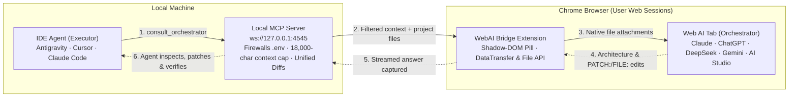

<div align="center">


# WebAI Bridge
### The Zero-Token MCP Orchestrator

**Connect your IDE agent directly to your logged-in Claude, ChatGPT, Gemini, AI Studio, and DeepSeek browser sessions via MCP — zero bridge-added API token billing, native file uploads, and minimal context-sync overhead.**

[](https://github.com/GoulagmanYt/webai-bridge/stargazers)
[](LICENSE)
[](https://github.com/GoulagmanYt/webai-bridge/actions)
[](https://github.com/GoulagmanYt/webai-bridge/releases/latest)
[](#-the-double-billing-trap)
[](https://modelcontextprotocol.io/)
[](CONTRIBUTING.md)

<p align="center">
  
  
  
  
  
</p>

[Quickstart](#quickstart) · [Why WebAI Bridge?](#why-webai-bridge) · [Supported Platforms](#supported-web-platforms) · [Architecture](#how-it-works) · [Testing & Coverage](#testing--verification-coverage) · [Security FAQ](#security-privacy--anti-ban-faq) · [Releases](https://github.com/GoulagmanYt/webai-bridge/releases/latest)

</div>

---

## Why WebAI Bridge?

### The Double-Billing Trap
Developers often already maintain flat-rate or web access accounts on **Claude**, **ChatGPT**, **Gemini**, **Google AI Studio**, or **DeepSeek**, yet pay separately on per-token API meters inside IDE coding agents (Antigravity IDE, Cursor, Claude Code, Cline, Roo Code).

**WebAI Bridge removes the extra API hop** when you want your local IDE agent to collaborate with your logged-in browser tab over the official **Model Context Protocol (MCP)**. Each platform's own subscription requirements, usage caps, and Terms of Service still apply.

### Fixed Two-Agent Architecture
* **Executor (Local IDE Agent):** Runs in your editor. Gathers local context, applies inspected code edits, runs verification commands, and reports results.
* **Orchestrator (Browser Web AI):** Runs in your browser tab. Performs architectural reasoning and emits structured `PATCH:` / `FILE:` proposals.

---

## Comparison: Why It Wins

| Feature | Manual Copy-Paste | IDE Pay-Per-Token API | WebAI Bridge |
|---|:---:|:---:|:---:|
| **Bridge Metering Fee** | None (web UI only) | Billed per API token | **$0 bridge API fee (uses your web session; platform limits apply)** |
| **Project File Upload** | Manual copy/paste | Automated via API | **Native browser DataTransfer / File API (`<= 2 MB` per file)** |
| **Context Management** | Manual re-pasting | Re-sent per API call | **Turn-1 discovery cap (`18,000` chars default) + unified diffs & `git diff --stat`** |
| **Secrets Protection** | Manual vigilance | Depends on client config | **Server file firewall: refuses `.env`, keys, and `.git/`** |
| **Code Application** | Manual file edits | Applied in editor | **Agent-inspected `PATCH:`/`FILE:` edits in `projectRoot` + checks** |
| **Model Switching** | Separate tabs manually | Requires API key / model access | **Switch active web tab between requests (subject to DOM selectors)** |

---

## Quick Demo

```
[ IDE Split-Screen: Antigravity / Cursor ]              [ Browser Tab: Claude / ChatGPT / Gemini / DeepSeek ]
  1. User prompts: "Refactor auth system"
  2. IDE Agent invokes consult_orchestrator  -------->   3. Floating status pill turns Amber (Busy)
                                                        4. Project files natively attached (DataTransfer API)
                                                        5. .env & secret keys automatically blocked
  7. Edits applied & checked autonomously  <--------   6. Web AI outputs PATCH:/FILE: proposals
```

> **Result:** Native attachment uploads, server-side secret filtering, and structured diff/patch round-trips over local MCP.

---

## Supported Web Platforms

WebAI Bridge connects to whatever model and thinking tier you currently have open in your browser tab, rather than hardcoding model API IDs. **New models or reasoning modes added to the existing chat interface work without extension updates, as long as the site's DOM selectors remain compatible** (major frontend redesigns may require selector updates in [`extension/content-providers.js`](extension/content-providers.js)).

| Web Platform | Hostname (`manifest.json`) | Notes |
|---|---|---|
| **OpenAI ChatGPT** | `chatgpt.com` | Supports whatever ChatGPT model/thinking tier your session has active. |
| **Anthropic Claude** | `claude.ai` | Assistant response extraction + composer-scoped upload chip delta checks. |
| **Google Gemini** | `gemini.google.com` | Supports Quill/rich-textarea injection and excluded `<user-query>` echo filtering. |
| **Google AI Studio** | `aistudio.google.com` | Direct browser tab integration under the Google Gemini / AI Studio web UI. |
| **DeepSeek Chat** | `chat.deepseek.com` | Hash-free selectors and DeepThink reasoning container filtering. |

> [!TIP]
> **Switch platforms between requests:** Open tabs for different providers (for example Claude, ChatGPT, and Gemini) and click the Obsidian Signal floating pill on whichever tab should take over next — it turns **Emerald (`Bridge · Live`)** once connected. *(Pill clicks are locked while a request is `Busy`.)*

---

## How It Works



---

## Quickstart

### Prerequisites
- **Node.js `>= 18`** (required to run `extension/bridge.mjs`, including when using the release ZIP)
- **Google Chrome** (or another Chromium browser supporting Manifest V3 unpacked extensions)

### Step 1: Get the Package
Download `webai-bridge.zip` from the [latest release](https://github.com/GoulagmanYt/webai-bridge/releases/latest) and unzip it into a permanent folder (e.g. `D:/webai-bridge` or `~/webai-bridge`).  
*(The release archive includes pre-installed `node_modules`, `extension/`, `skills/`, `package.json`, and `package-lock.json`, so no `npm install` step is needed.)*

<details>
<summary>Or clone from source</summary>

```bash
git clone https://github.com/GoulagmanYt/webai-bridge.git
cd webai-bridge
npm install
```
</details>

---

### Step 2: Load the Chrome Extension
1. Open `chrome://extensions` in Google Chrome (or Brave, Edge, Chromium).
2. Toggle **Developer mode** (top-right).
3. Click **Load unpacked** and select the `extension` folder inside this repository.
4. Ensure the extension is enabled.

---

### Step 3: Connect Your IDE Agent (MCP Config)

WebAI Bridge supports any MCP client that connects to standard I/O (stdio). Choose your editor:

<details open>
<summary><b>Antigravity IDE</b></summary>

Open **Manage MCPs → View raw config** (`mcp_config.json`) and add:

```json
{
  "mcpServers": {
    "webai-bridge": {
      "command": "node",
      "args": ["D:/webai-bridge/extension/bridge.mjs"]
    }
  }
}
```
*(Update `D:/webai-bridge` to your actual installation path).* Save and click **Refresh**.

**Optional (Agent Rule & Skill Setup):** To mirror the bridge protocol rules directly in `~/.gemini/GEMINI.md` and install the orchestration skill:
```bash
node D:/webai-bridge/extension/bridge.mjs --install-rule
node D:/webai-bridge/extension/bridge.mjs --install-skill
```
</details>

<details>
<summary><b>Cursor</b> (<code>.cursor/mcp.json</code>)</summary>

Add to your project's `.cursor/mcp.json` or global cursor settings:

```json
{
  "mcpServers": {
    "webai-bridge": {
      "command": "node",
      "args": ["D:/webai-bridge/extension/bridge.mjs"]
    }
  }
}
```
</details>

<details>
<summary><b>Claude Code CLI</b></summary>

Register the server with a single terminal command:

```bash
claude mcp add webai-bridge node D:/webai-bridge/extension/bridge.mjs
```
</details>

<details>
<summary><b>Cline / Roo Code (VS Code Extension)</b></summary>

Add to `cline_mcp_settings.json`:

```json
{
  "mcpServers": {
    "webai-bridge": {
      "command": "node",
      "args": ["D:/webai-bridge/extension/bridge.mjs"],
      "disabled": false,
      "autoApprove": []
    }
  }
}
```
</details>

### Step 4: Install the Autonomous Orchestrator Skill (Recommended)

To keep your IDE agent operating in a **closed autonomous loop** (inspecting returned edits/commands for safety, applying changes inside `projectRoot`, running verification checks, looping while `loop=continue`, and yielding to you on standalone `TASK_COMPLETE` or a physical blocker such as `NO_TAB` / `NO_INPUT` / `GENERATION_NOT_STARTED`):

#### Automatic Installation (One command)
Run from your installation folder:
```bash
node D:/webai-bridge/extension/bridge.mjs --install-skill
```

#### Manual Skill Installation
Copy the bundled `skills/webai-orchestrator` folder into your agent's skills location:

* **Antigravity IDE**:
  * Windows (PowerShell):
    ```powershell
    Copy-Item -Path "D:\webai-bridge\skills\webai-orchestrator" -Destination "$env:USERPROFILE\.gemini\config\skills\" -Recurse -Force
    ```
  * Linux / macOS:
    ```bash
    cp -r D:/webai-bridge/skills/webai-orchestrator ~/.gemini/config/skills/
    ```

* **Claude Code / Cursor / Other Agents**:
  Copy `skills/webai-orchestrator` into your project's `.agents/skills/webai-orchestrator` or `.cursor/skills/`.

---

## Daily Workflow

1. Open your AI website of choice in Chrome:
   * [claude.ai](https://claude.ai)
   * [chatgpt.com](https://chatgpt.com)
   * [chat.deepseek.com](https://chat.deepseek.com)
   * [gemini.google.com](https://gemini.google.com)
   * [aistudio.google.com](https://aistudio.google.com)
2. Verify the floating Obsidian Signal pill at the top of the tab turns **Emerald (`Bridge · Live`)** — or click it once to switch between **Dedicated** and **Standby** (or reclaim a replaced tab).
3. Prompt your IDE agent naturally — it delegates the heavy lifting autonomously!

| Indicator | Status | Action |
|:---:|---|---|
| **Emerald** | **`Bridge · Live`** | Active & ready! Tab handles incoming requests (click to park in Standby). |
| **Amber** | **`Bridge · Busy` / `Upload`** | Uploading attachments or streaming response (clicks disabled while running). |
| **Cobalt** | **`Bridge · Connecting`** | Waiting for the local MCP server handshake on WebSocket port `4545`. |
| **Slate** | **`Bridge · Standby`** | Tab paused intentionally; click the pill once to claim and connect. |
| **Rose** | **`Bridge · Replaced` / `Offline`** | Another tab claimed the bridge or server is unreachable; click to reconnect. |

Click the **WebAI Bridge extension icon** in Chrome's toolbar to open the **Obsidian Signal Popup**: view live active-tab telemetry (`Provider`, `Tab Mode`, `Upload State`, `Active Job`), change WebSocket port or optional Session Auth Token (with reveal toggle and `Enter`-to-save), toggle **Debug Mode**, and copy/clear the runtime log buffer.

> [!TIP]
> **Need a clean slate?** Open a **New Chat** in the web tab. WebAI Bridge automatically detects new conversations and sends fresh context bundles!

---

## Agent Protocol Specification

The protocol definition lives in [`extension/protocol.mjs`](extension/protocol.mjs) and is served via the standard MCP `instructions` capability.

### Tools

| Tool | Parameters | Description |
|---|---|---|
| `consult_orchestrator` | `projectRoot` *(required)*<br/>`conversation_history_and_context` *(required)*<br/>`task` *(required)*<br/>`filePaths` *(paths or `path:start-end` slices)*<br/>`response_type` (`code_changes` \| `analysis`)<br/>*Optional:* `output_mode` (`auto` \| `patch` \| `full` \| `analysis`), `context_mode` (`auto` \| `minimal` \| `full` \| `none`), `file_mode` (`auto` \| `diff` \| `full`), `target_files`, `max_context_chars`, `jobId`, `softTimeoutMs` | Delegates a non-trivial architectural, refactoring, or debugging task to the Web AI Orchestrator in a closed autonomous loop. Supports incremental diffs, line-range slices, hybrid `PATCH:`/`FILE:` output, and `jobId` stream resumption. |
| `orchestrator_status` | *Optional:* `inspect`, `includeLogs`, `selector`, `limitLogs`, `action`, `jobId`, `softTimeoutMs` | Checks connectivity, active provider, cumulative `sessionMetrics` (token/latency/diff counters), buffered job state, or runs live DOM & debug-log diagnostics (`inspect=true`). |

### Structured Reply Format
Successful replies begin with a telemetry-enriched envelope header, optional refusal/dry-run/continuation lines, and the Orchestrator's structured output:

````text
[orchestrator protocol=1 provider=Claude status=ok response_type=code_changes mode=auto files_sent=1 files_diff=1 files_unchanged=2 files_refused=1 loop=continue in_tok=640 out_tok=210 saved_tok=1850 ms=11200]
[refused] .env (sensitive file (credentials, keys or VCS internals))
[patch_check ok=1 failed=0]
[loop=continue] Apply changes or run requested checks and immediately call consult_orchestrator with the delta; do not yield to the human user.

PATCH: /path/to/project/src/auth.ts
```patch
// Exact SEARCH/REPLACE hunks using <<<<<<< SEARCH, =======, and >>>>>>> REPLACE delimiters
```

FILE: /path/to/project/src/new-helper.ts
```ts
// Complete file for brand-new or small (<150 lines) files
```
````

- **Hybrid Output Contract**: Existing files (`>=150` lines) use `PATCH: <absolute path>` with `<<<<<<< SEARCH` / `=======` / `>>>>>>> REPLACE` hunks wrapped inside a fenced `patch` block; brand-new, small (`<150` lines), or heavily rewritten files use `FILE: <absolute path>`; file tree operations use `DELETE: <absolute path>` and `RENAME: <old_abs_path> -> <new_abs_path>`.
- **Bridge-Side Dry-Run & Closed Loop**: `bridge.mjs` non-destructively validates `PATCH:`, `DELETE:`, and `RENAME:` directives against disk (`[patch_check ok=... failed=...]`) and sets `loop=continue|complete` mechanically from standalone `TASK_COMPLETE` signals. The Executor inspects replies for safety, applies changes inside `projectRoot`, runs project tests, and loops while `loop=continue`.

### Protocol Error Handling

| Error Code | Description | Automated Recovery Action |
|---|---|---|
| `NO_TAB` | No browser tab dedicated. | Ask the user to open a supported AI tab and click the floating pill until it shows Emerald (`Bridge · Live`). |
| `NO_INPUT` | Chat textarea not found. | Open a fresh new chat in the browser tab. |
| `TAB_DISCONNECTED` | Tab closed mid-request. | Check status and retry once. |
| `TIMEOUT` | Generation deadline exceeded. | Resumes stream automatically via `jobId` or retry with smaller task. |
| `UPLOAD_FAILED` | File attachment failed. | Clear textarea, retry once with clean state. |
| `GENERATION_NOT_STARTED`| Blocked by captcha, rate limit or upload spinner. | Prompt user to inspect the browser tab. |
| `BAD_REQUEST` | Arguments validation failed. | Fix parameters according to schema. |

---

## Testing & Verification Coverage

All automated checks run in **Node.js `>= 18`**:
- **GitHub Actions CI** ([`.github/workflows/ci.yml`](.github/workflows/ci.yml)): runs `npm ci`, `npm test`, and `npm run audit`.
- **Standalone local harness** (`node test/live-integration.mjs`): run manually/locally outside CI.

| Command | Scope & Count | Environment / What It Verifies |
|---|---|---|
| `npm run check` | `10` scripts + `manifest.json` | Syntax validation (`node --check`) across all `.mjs`/`.js` extension modules and valid Manifest V3 JSON. |
| `npm run test:unit` | `72` tests (`6` files) | Native `node --test` suite across [`test/safety.test.mjs`](test/safety.test.mjs) (`10`, `1` conditional skip on unprivileged Windows symlinks), [`test/protocol.test.mjs`](test/protocol.test.mjs) (`13`), [`test/protocol.e2e.test.mjs`](test/protocol.e2e.test.mjs) (`20`), [`test/comparison.test.mjs`](test/comparison.test.mjs) (`12`), [`test/milestone4.test.mjs`](test/milestone4.test.mjs) (`10`), and [`test/patch-delta.test.mjs`](test/patch-delta.test.mjs) (`7`). |
| `npm run doctor` | `36` checks | Static & contract checks in [`scripts/doctor.mjs`](scripts/doctor.mjs): required files, MV3 script order, canonical port `4545`, filename sanitization, protocol/patch helpers, upload vectors, and Obsidian Signal UI exports. |
| `npm test` | Core test suite | Runs `npm run check && npm run test:unit && npm run doctor`. |
| `npm run audit` | Dependency security | Runs `npm audit --audit-level=moderate`. |
| `node test/live-integration.mjs` | `8` E2E steps *(local only, not in CI)* | Spawns real `extension/bridge.mjs` (`port 4546`) with simulated MCP stdio & WebSocket peers to verify origin rejection, auth handshake, canonical tools, `consult_orchestrator`, legacy alias compatibility, and disconnect resilience. |

> [!NOTE]
> **Coverage Scope & Boundaries:**
> - **Headless unit & contract suites (`safety.test.mjs`, `protocol.test.mjs`, `comparison.test.mjs`, `milestone4.test.mjs`, `patch-delta.test.mjs`, `doctor.mjs`):** Run in Node.js using mocked DOM / Shadow DOM elements and mocked `chrome.*` APIs (`storage`, `tabs`, `runtime`).
> - **Local MCP & WebSocket harnesses (`protocol.e2e.test.mjs`, `live-integration.mjs`):** Spawn the real `extension/bridge.mjs` MCP stdio + WebSocket server locally against simulated MCP and WebSocket browser peers (no live Chrome process or real AI site is driven).
> - **Not covered by headless CI:** Real Chrome extension loading, live Obsidian Signal popup & Shadow-DOM floating pill layout/interactions, Chromium `chrome.*` IPC, and live selector compatibility against third-party AI web apps require manual verification in Chrome after reloading the unpacked extension.

---

## Configuration

Port priority: CLI `--port <number>` (or `--port=<number>`) -> `WEBAI_BRIDGE_PORT` -> `ANTIGRAVITY_BRIDGE_PORT` -> `BRIDGE_PORT` -> `4545`.

| Environment Variable | Default | Purpose |
|---|:---:|---|
| `WEBAI_BRIDGE_PORT` / `BRIDGE_PORT` | `4545` | Port for the local WebSocket bridge (`1024`–`65535`). `ANTIGRAVITY_BRIDGE_PORT` is also supported for legacy setups. |
| `WEBAI_BRIDGE_TOKEN` | *auto-generated* | Fixed session token for WebSocket authentication (enables strict token enforcement; active session metadata is stored in `~/.webai-bridge/session.json` with POSIX `0600` permissions — best-effort on Windows). |
| `WEBAI_BRIDGE_STRICT_AUTH` | *unset (`false`)* | Set to `1` to enforce the auto-generated token from `~/.webai-bridge/session.json` on every WebSocket upgrade (when both this and `WEBAI_BRIDGE_TOKEN` are unset, CSWSH `Origin` checks and per-session handshakes remain active without rejecting tokenless local tabs). |
| `BRIDGE_EXTRA_ROOTS` | *none* | Additional allowed directories for file uploads (separated by `;` on Windows, `:` elsewhere). |
| `BRIDGE_INSTALL_RULE` | *none* | Set to `1` to automatically install the agent protocol into `~/.gemini/GEMINI.md`. |
| `BRIDGE_SHOW_LEGACY_TOOLS` | *none* | Set to `1` to include deprecated alias tools in `tools/list` (hidden by default to save IDE agent tokens; aliases still work at runtime). `BRIDGE_HIDE_LEGACY_TOOLS=1` remains supported as an override. |
| `BRIDGE_CONTEXT_EXCLUDE` | *none* | Comma- or semicolon-separated glob patterns excluded from Turn-1 auto-discovered context (in addition to optional project `.webaiignore`, lockfiles, and bridge self-rules/skills). |
| `BRIDGE_LOG_FILE` | *none* | File path to append timestamped bridge diagnostic logs. |
| `BRIDGE_NO_WATCHDOG` | *none* | Set to `1` to disable the parent-process orphan watchdog. |

---

## Security, Privacy & Anti-Ban FAQ

### Can using a Web AI bridge trigger account restrictions?
WebAI Bridge avoids private undocumented APIs, credential harvesting, and headless browser automation (Puppeteer/Playwright) that anti-bot systems target. It runs inside your own logged-in Chrome tab at interactive developer cadence; however, all usage remains subject to each platform's rate limits and Terms of Service.

### Can my `.env` files or secret keys leak?
**Blocked by the server file firewall.** Before reading any attachment:
- Only files inside `projectRoot` (plus explicitly configured `BRIDGE_EXTRA_ROOTS`, with symlinks resolved) are accepted.
- Sensitive paths matching `.env`, private keys, SSH credentials, tokens, or VCS internals (`.git/`) are **refused and listed** under `[refused]`.
- Individual files larger than `2 MB` are rejected to avoid oversized uploads.

### Can the Web AI execute destructive shell commands on my machine?
**Enforced for file access on disk; policy-driven in the IDE agent.** WebAI Bridge never executes shell commands on its own and treats Orchestrator output as untrusted text proposals. While the server strictly enforces the file-upload firewall inside `projectRoot` / `BRIDGE_EXTRA_ROOTS`, inspecting returned edits and preventing unsafe shell commands or unreviewed dependency installs depends on the connected **IDE agent** following the MCP instructions (WebAI Bridge is not an OS process sandbox).

### Does any data pass through third-party servers?
Bridge communication between your IDE and Chrome extension stays strictly local on `ws://127.0.0.1:4545` (guarded by WebSocket `Origin` validation and optional per-session token auth), with no telemetry or intermediary cloud proxy. Prompts and files you choose to dispatch are processed directly by the AI web platform open in your dedicated tab under that provider's privacy terms.

---

## License & Credits

Released under the **[GNU General Public License v3.0](LICENSE)**.

* **Original Creator:** [antigravity-universal-ai-bridge](https://github.com/Eyad-Eladawy/antigravity-universal-ai-bridge) by **Eyad (Trignod.ai)**.
* **Maintainer & Lead:** Robin ([@GoulagmanYt](https://github.com/GoulagmanYt)).
* Complete attribution and legal notices are detailed in [NOTICE.md](NOTICE.md).

*Trademarks: Antigravity, Claude, ChatGPT, Gemini, Google AI Studio, and DeepSeek are trademarks of their respective owners. Used here solely to indicate compatibility.*
